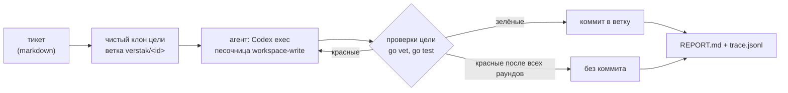

# Verstak

Верстак — рабочее место кодоагента. Сюда приходят тикеты о том, что не так с Пыхтуном (бот в
Minecraft, отдельный репозиторий persona-agent). Агент чинит код Пыхтуна в своём клоне.
Верстак сам прогоняет проверки, коммитит зелёную правку в ветку тикета и пишет отчёт. В репозиторий
Пыхтуна ничего не попадает, пока разработчик сам не заберёт ветку.

## Как это работает



- **Цель только читается.** Клон берёт закоммиченное состояние базовой ветки. У клона нет remote,
  поэтому пушить из него некуда. Незакоммиченные файлы цели в клон не попадают.
- **Вердикт ставит верстак, а не агент.** «Готово» означает, что проверки прошли в нашем прогоне.
  Красные проверки уходят агенту следующим раундом в ту же сессию: он помнит, что уже прочитал.
- **Короткий стартовый промпт.** Инструкции, персона и тикет лежат файлами в `.verstak/` клона,
  агент читает их сам (папка `workplace/`, вшита в бинарь).
- **Замеры.** `trace.jsonl` хранит шаги со временем (клон, раунды агента, проверки) и токены,
  включая кэш. `agent.jsonl` — сырой поток событий Codex.

## Запуск

```
cp verstak.example.json verstak.json   # пути и модель под себя
go build -o bin/verstak.exe ./cmd/verstak
bin/verstak.exe -target persona-agent tickets/example-takeoff-quiet.md
```

Отчёт печатается в конце. Забрать ветку в цель можно командой из отчёта: `git fetch <клон>
verstak/<id>`.

Codex берётся из приложения Codex (самый свежий `codex.exe`), иначе из PATH. Конкретный путь
задаётся полем `codex.bin`.

## Дальше

См. [docs/design.md](docs/design.md): тикеты из игры, Docker, мастерская в Minecraft, голос.
