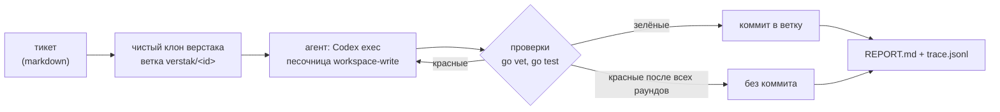

# Verstak

Верстак — рабочее место кодоагента, который дорабатывает сам себя. Тикет описывает, что
улучшить в самом верстаке. Агент правит код в своём клоне, верстак сам прогоняет проверки,
коммитит зелёную правку в ветку тикета и пишет отчёт. В основной репозиторий ничего не попадает,
пока разработчик сам не заберёт ветку.

Персонажа пока нет, он появится позже.

## Как это работает



- **Запретный список.** Репозитории из `deny` верстак не клонирует и не читает, даже если их
  случайно впишут в цели. В примере конфига там persona-agent и unionclef: они работают, и
  рисковать ими незачем.
- **Работающая копия в безопасности.** Агент правит клон, а запущен верстак, собранный из
  основного репозитория. Ошибка агента не может сломать текущий запуск. У клона нет remote,
  поэтому пушить из него некуда.
- **Вердикт ставит верстак, а не агент.** «Готово» означает, что проверки прошли в нашем прогоне.
  Красные проверки уходят агенту следующим раундом в ту же сессию: он помнит, что уже прочитал.
- **Короткий стартовый промпт.** Инструкции и тикет лежат файлами в `.verstak/` клона, агент
  читает их сам (папка `workplace/`, вшита в бинарь).
- **Замеры.** `trace.jsonl` хранит шаги со временем (клон, раунды агента, проверки) и токены,
  включая кэш. `agent.jsonl` — сырой поток событий Codex.

## Запуск

Каждый тикет работает в своём контейнере Docker. Папки хоста туда не монтируются, наружу
открыт только путь к OpenAI через прокси. Подробно — [docs/security.md](docs/security.md).

```
cp verstak.example.json verstak.json        # пути, модель, docker.auth — логин агента
# из релиза openai/codex: codex-package-x86_64-unknown-linux-musl.tar.gz (сверить sha256),
# из него bin/codex, bin/codex-code-mode-host и codex-path/rg — в отдельную папку
docker build --build-context codex=<эта папка> -t verstak-agent:latest -f docker/Dockerfile .
go build -o bin/verstak.exe ./cmd/verstak
bin/verstak.exe -probe                      # изоляция: 10 проверок изнутри контейнера
bin/verstak.exe -target verstak tickets/example-own-tests.md
```

Готовая ветка попадает в репозиторий-приёмник `<work>/inbox.git`, команда `git fetch` — в
отчёте. Красная работа приходит патчем `out/changes.diff`. Журнал прокси (`egress.jsonl`)
показывает, куда агент пытался выйти.

Образ собирается из основного репозитория. Правки агента попадут в работу, только когда
ветку заберут и образ пересоберут.

## Пульт

`bin/verstak-panel.exe` (Rust, egui; исходники в `panel/`):
- слева тикеты: статус и время;
- справа выбранный тикет: вживую, что делает агент (сообщения, команды, правки файлов, шаги
  верстака), отчёт, патч или diff ветки, шаги со временем, куда агент выходил через прокси;
- кнопки: новый тикет, стоп (убить контейнер), проверка изоляции, «забрать ветку в верстак».
  Ветка только скачивается (git fetch) в основной репозиторий, сливает разработчик.

Сборка: `cargo build --release` в `panel/`, затем exe в `bin/`. Один тикет за раз: у всех
тикетов общий прокси.

`-unsafe-host` запускает агента прямо на этой машине. Только для отладки самого верстака.

## Дальше

См. [docs/design.md](docs/design.md).
