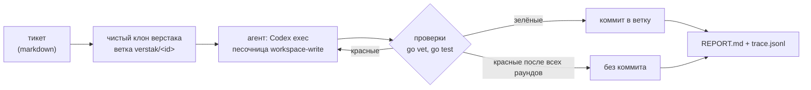

# Verstak

Верстак — рабочее место кодоагента, который дорабатывает сам себя. Тикет описывает, что
улучшить в самом верстаке. Агент правит код в своём клоне, верстак сам прогоняет проверки,
коммитит зелёную правку в ветку тикета и пишет отчёт. В основной репозиторий ничего не попадает,
пока разработчик сам не заберёт ветку.

Персонажа пока нет, он появится позже.

## Как это работает



- **Запретный список.** Репозитории из `deny` верстак не клонирует и не читает, даже если их
  случайно впишут в цели. В примере конфига там persona-agent и unionclef: они работают, и
  рисковать ими незачем.
- **Работающая копия в безопасности.** Агент правит клон, а запущен верстак, собранный из
  основного репозитория. Ошибка агента не может сломать текущий запуск. У клона нет remote,
  поэтому пушить из него некуда.
- **Вердикт ставит верстак, а не агент.** «Готово» означает, что проверки прошли в нашем прогоне.
  Красные проверки уходят агенту следующим раундом в ту же сессию: он помнит, что уже прочитал.
- **Короткий стартовый промпт.** Инструкции и тикет лежат файлами в `.verstak/` клона, агент
  читает их сам (папка `workplace/`, вшита в бинарь).
- **Замеры.** `trace.jsonl` хранит шаги со временем (клон, раунды агента, проверки) и токены,
  включая кэш. `agent.jsonl` — сырой поток событий Codex.

## Запуск

**Живые запуски — только в изоляции** (Docker, затем отдельная машина): тесты, которые пишет
агент, исполняются при проверках, и на хосте у них были бы права пользователя. Подробно —
[docs/security.md](docs/security.md). Пока песочницы нет, запуск без флага `-unsafe-host`
отказывается работать. Этот флаг только для отладки самого верстака.

```
cp verstak.example.json verstak.json   # пути и модель под себя
go build -o bin/verstak.exe ./cmd/verstak
bin/verstak.exe -target verstak tickets/example-own-tests.md
```

Отчёт печатается в конце. Забрать ветку можно командой из отчёта: `git fetch <клон>
verstak/<id>`.

Codex берётся из приложения Codex (самый свежий `codex.exe`), иначе из PATH. Конкретный путь
задаётся полем `codex.bin`.

## Дальше

См. [docs/design.md](docs/design.md).
